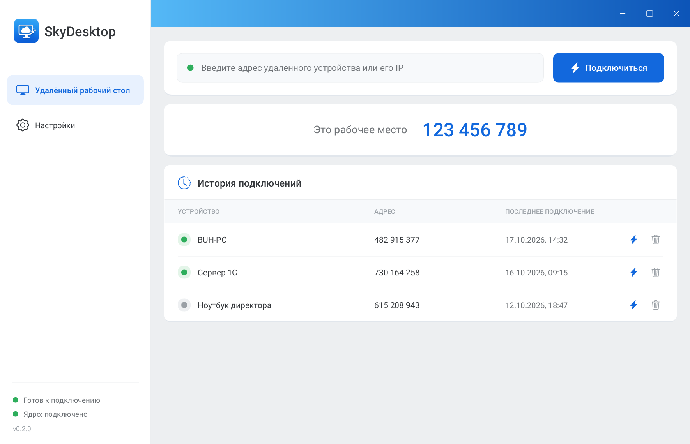
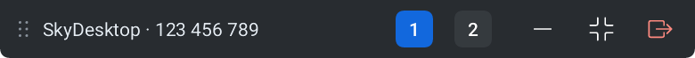
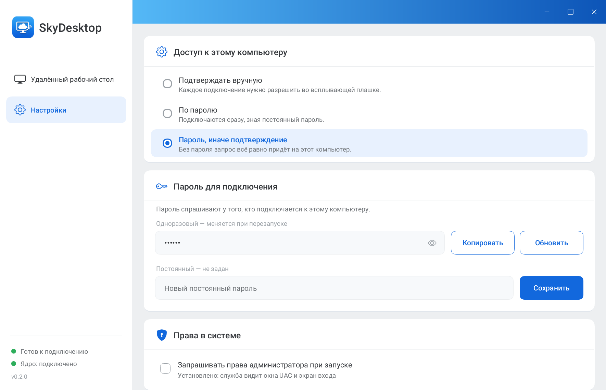
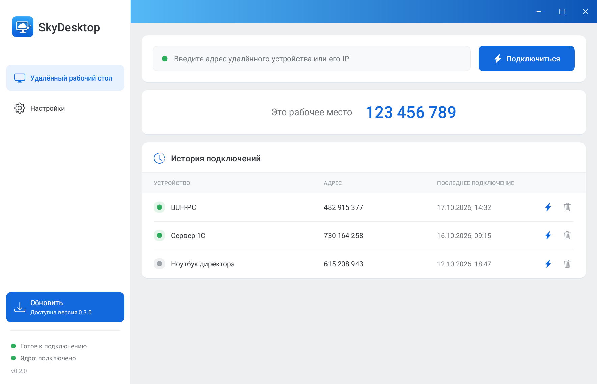

# SkyDesktop

Удалённый рабочий стол для Windows: свой интерфейс поверх доработанного ядра
[RustDesk](https://github.com/rustdesk/rustdesk). Один `SkyDesktop.exe` — и
панель, и окно сеанса, и служба, принимающая подключения. Ни браузера, ни
WebView, ни драйверов GPU: интерфейс рисуется на процессоре, шрифты и значки
вшиты в exe.



## Возможности

- **Подключение в одно действие** — ввести адрес из девяти цифр (или IP в
  локальной сети) и нажать Enter.
- **Несколько мониторов** — на шторке окна сеанса кнопки «1», «2», …
  переключают монитор удалённого компьютера, как в AnyDesk.
- **Чёткая картинка** — 4:4:4 без потери цвета, выбор кодека (AV1, H.265,
  H.264), адаптивный битрейт и частота кадров; кадр один к одному без
  пересчёта, когда разрешения совпадают.
- **Доступ без присмотра** — подтверждение вручную, постоянный пароль или
  и то и другое; одноразовый пароль меняется при перезапуске.
- **Окна UAC и экран входа** — после установки подключения принимает служба
  Windows от имени системы, поэтому удалённой стороне видно всё.
- **Свои серверы** — список серверов связи приложение забирает из каталога
  нод и регистрируется сразу на всех; для исходящих подключений выбирается
  самый быстрый.
- **История подключений** — с именами компьютеров и отметкой, кто сейчас
  в сети.
- **Обновление с GitHub** — панель сама находит новую версию и ставит её по
  нажатию кнопки.

| Окно сеанса: шторка с переключением мониторов |
| --- |
|  |

| Настройки доступа | Доступно обновление |
| --- | --- |
|  |  |

## Установка

1. Скачайте `SkyDesktop.exe` из [последнего релиза](https://github.com/qdpops/SkyDesktop/releases/latest).
2. Запустите — программа работает сразу, без установки.
3. Чтобы удалённой стороне были видны окна UAC и экран входа, нажмите
   в панели **«Установить»**: программа скопируется в Program Files и
   зарегистрирует службу.

Windows может предупредить о неизвестном издателе — exe пока не подписан.
Контрольная сумма лежит рядом в релизе: `SkyDesktop.exe.sha256`.

## Обновление

При запуске и затем раз в шесть часов панель спрашивает GitHub о последнем
релизе. Если он новее, в боковой панели появляется кнопка **«Обновить»**.
По нажатию программа скачивает exe, сверяет его SHA-256 с файлом из того же
релиза и ставит штатным путём ядра: один запрос UAC, служба перезапускается
сама. Если контрольная сумма не совпала, обновление отменяется.

Код — `core/skydesktop-app/src/update.rs`.

## Сборка из исходников

Нужны:

- Rust (stable, `x86_64-pc-windows-msvc`);
- Visual Studio Build Tools 2022 и Windows SDK;
- [vcpkg](https://github.com/microsoft/vcpkg) с библиотеками кодеков;
- `libclang` для bindgen (например, `pip install libclang`).

```bash
# 1. Ядро: RustDesk нужной версии + правки SkyDesktop из vendor/patches
scripts/fetch-rustdesk.sh

# 2. Кодеки (один раз, vcpkg — в папке проекта)
git clone https://github.com/microsoft/vcpkg && vcpkg/bootstrap-vcpkg.bat
vcpkg/vcpkg install --triplet x64-windows-static aom libjpeg-turbo libvpx libyuv opus

# 3. Сборка
scripts/build-skydesktop.sh          # релиз → core/target/release/SkyDesktop.exe
scripts/build-skydesktop.sh debug    # отладочная сборка
```

Пути к Build Tools, SDK и libclang задаются в `scripts/env-msvc.sh` —
поправьте их под свою машину.

Адрес каталога нод вшивается в сборку:

```bash
SKYDESKTOP_DIRECTORY=https://nodes.example.com/nodes scripts/build-skydesktop.sh
```

Тесты и скриншоты для этого README (рисуются на выдуманных данных):

```bash
cd core
cargo test -p skydesktop-app                          # тесты
cargo test -p skydesktop-app -- --ignored screenshots # docs/screenshots/*.png
```

## Выпуск версии

1. Поднимите `version` в `core/skydesktop-app/Cargo.toml` и закоммитьте.
2. Запустите `scripts/release.sh "Что нового"`.

Скрипт соберёт релиз, посчитает SHA-256 и создаст на GitHub релиз
`v<версия>` с файлами `SkyDesktop.exe` и `SkyDesktop.exe.sha256`. Через
несколько часов установленные копии предложат обновиться.

## Устройство

Один исполняемый файл работает в нескольких ролях — роль выбирается
аргументами, как и в самом ядре:

| Запуск | Роль |
| --- | --- |
| без аргументов | панель управления |
| `--connect <адрес> [пароль]` | окно удалённого сеанса |
| `--cm` | плашка запроса доступа, её запускает ядро |
| `--server`, `--service`, `--update`, … | служебные режимы ядра |

Каталоги:

- `core/skydesktop-app/` — оконное приложение: панель, плашка входящего
  подключения, окно сеанса, установка и обновление. Интерфейс рисуется на
  процессоре (`tao` + `softbuffer` + `tiny-skia` + `fontdue`).
- `core/skydesktop-bridge/` — типы и JSON-протокол обмена между окнами.
- `core/skydesktop-core/` — модель адаптивного качества.
- `vendor/patches/` — правки ядра RustDesk; `scripts/fetch-rustdesk.sh`
  накладывает их на исходники нужной версии в `vendor/rustdesk/`.
- `assets/` — шрифты Roboto, значки Bootstrap Icons и логотип.
- `server/directory/` — каталог нод: Worker для Cloudflare и агент регистрации.
- `server/self-hosted/` — своя серверная часть: hbbs, hbbr и каталог в Docker.

Сеанс и плашка — отдельные процессы: сбой сеанса не роняет панель. Они шлют
панели клиентов, метрики и имя удалённого компьютера POST-запросами на
`127.0.0.1` (`core/skydesktop-app/src/bridge.rs`). Обращения к ядру
блокирующие (IPC к службе), поэтому вынесены в отдельный поток
(`core/skydesktop-app/src/engine.rs`).

Данные: `%APPDATA%\SkyDesktop` — настройки, адрес устройства и история,
`%LOCALAPPDATA%\SkyDesktop\logs` — журналы. Установленный рядом RustDesk не
задет: у SkyDesktop своё имя, свой адрес устройства и своя служба.

> Если панель запущена не из установленной копии (например, из
> `core/target/release`), а служба установлена, ядро не пустит панель к службе
> и статус сети останется серым. Запускайте установленную копию или
> обновите её.

## Лицензия

[AGPL-3.0](LICENSE), как и ядро RustDesk, на котором построено приложение.
Шрифты Roboto (Google Fonts) и значки Bootstrap Icons (MIT) распространяются
под своими лицензиями.
